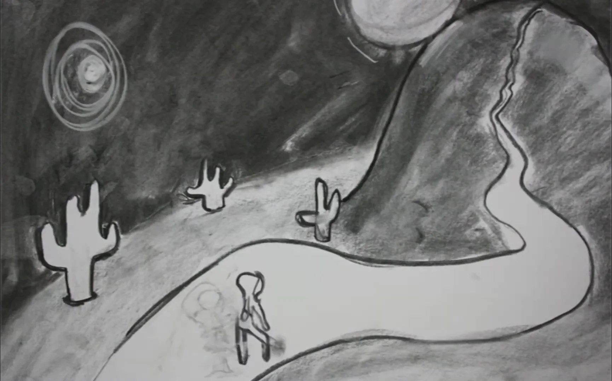

The final entry for my media certificate, the filmmaking component. It got 50 out of 50.

  <iframe src="https://www.youtube-nocookie.com/embed/sYXd_lHVwSA" title="Mind"
    loading="lazy" allow="accelerometer; autoplay; clipboard-write; encrypted-media; gyroscope; picture-in-picture"
    referrerpolicy="strict-origin-when-cross-origin" allowfullscreen></iframe>

I was inspired by artists like William Kentridge, and made my own pastiche of mental turmoil, evolution, history. Symbolic and abstract, surreal in a way.

To be kept in Mind.
