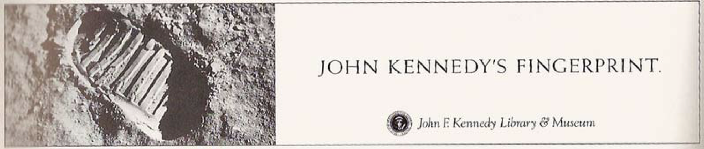
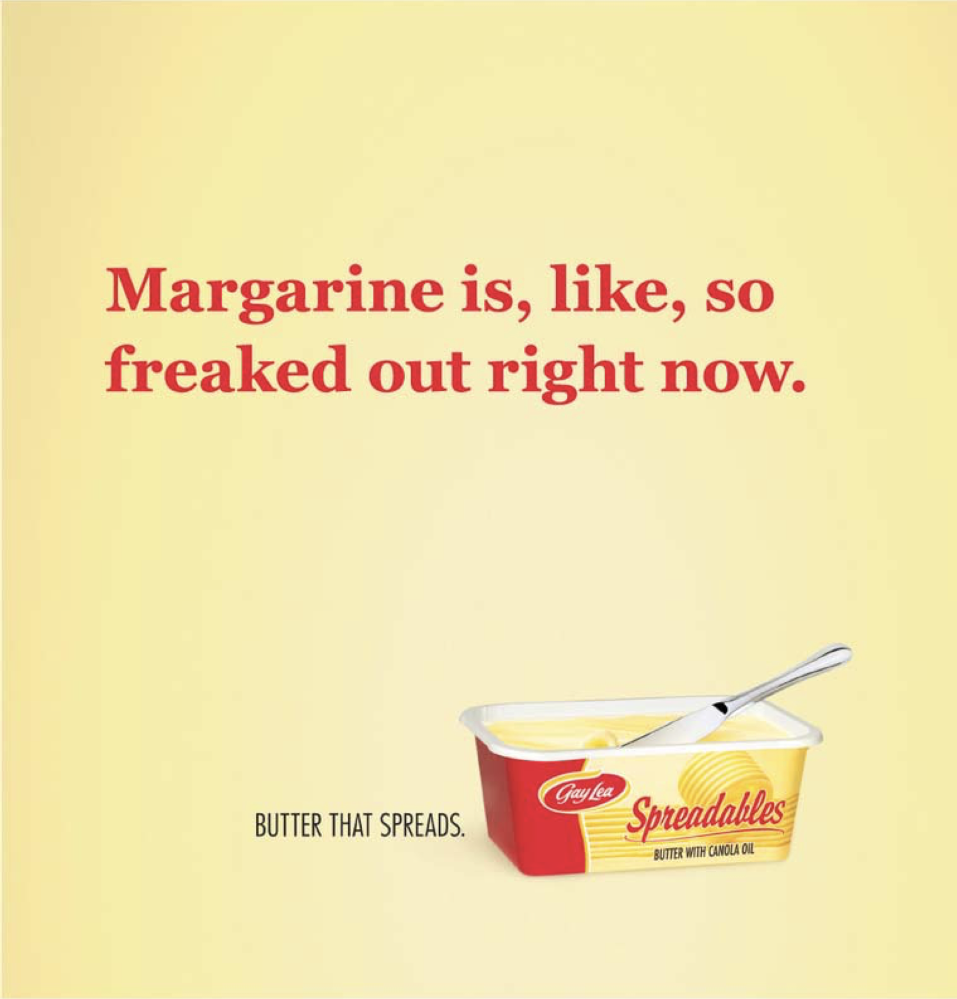
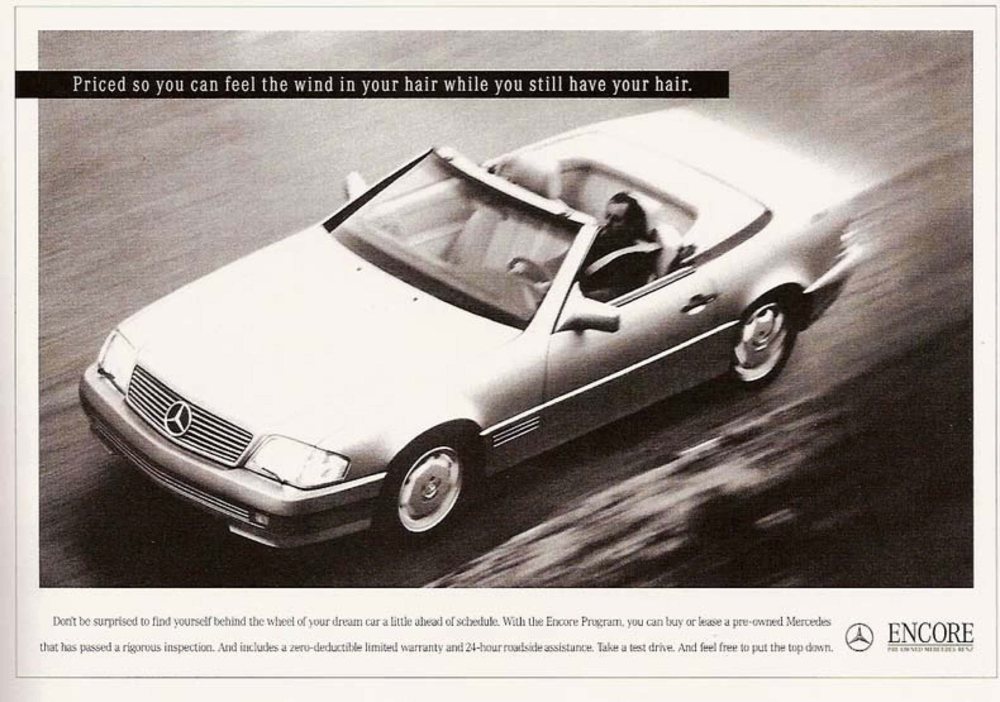
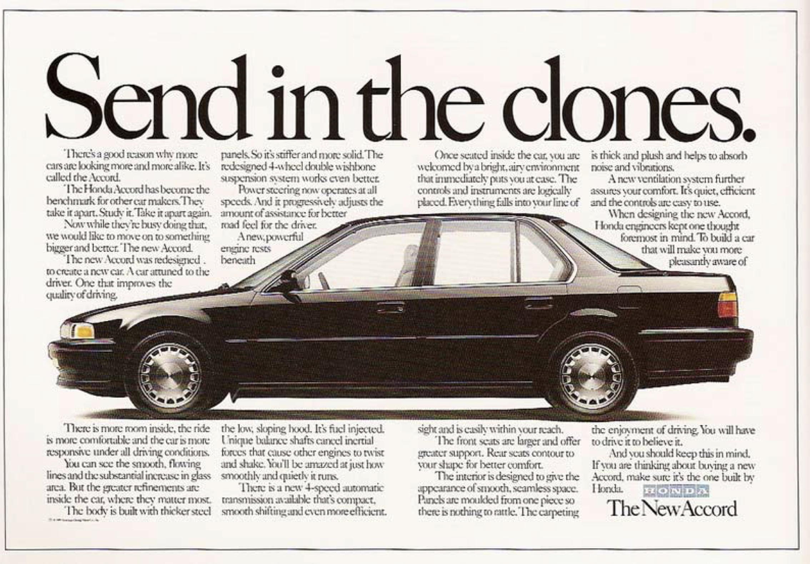

Suzanne Pope wrote *An Inconvenient Truth for Copywriters* around 2010. Group creative director at john st. in Toronto. Seventy-one pages, forty-odd ads, every agency credited.

Part One is the warning. The industry had gone visual. The awards were going to ads without a headline. Some agencies had started hiring two art directors and no writer. "If we as copywriters agree that words are now redundant, we ourselves will soon be redundant."

Part Two is the way out. Rhetoric. Metaphor, personification, hyperbole, irony, paradox, puns, parallelism, anesis. Two thousand years old and, she says, still amazingly sharp. Practise them like scales.

Her best line isn't hers. She takes a bad pun to Jerry Goodis, her first boss, and he hands it straight back. *If you're going to do a pun, it has to kick both ways.*

## Her examples

*Metaphor. John F. Kennedy Library & Museum. The Martin Agency, Richmond.*

*Personification. Gay Lea Spreadables. john st., Toronto.*

*Parallelism. Mercedes-Benz used cars. The Martin Agency, Richmond.*

*Pun. Honda Accord. Rubin Postaer & Associates, Los Angeles.*

You can name the device in every one. It tells you nothing about why they're good.

The device is a slot. What goes in the slot is the job.

## Special Buys

Not "weekly deals". Not "limited offers".

[*Special Buys.*](https://www.aldi.com.au/special-buys) Faintly wrong. Slightly foreign. "Buys" as a noun, which it barely is. People say it out loud in the aisle without embarrassment.

CBA's *can* (M&C Saatchi, 2012). It shouldn't hold. It held.

Bankwest, the *just enough* bank (Bear Meets Eagle On Fire, 2025). An apology right up until you notice it's a boast.

KFC cut its three most famous words down to *FLG* (Ogilvy, 2025).

DiDi's *Yes, I DiDi* (Sunday Gravy, 2025). Kicks both ways. Lodged in my head against my will.

I'd rather advertising just be advertising, but Pope credited everyone, so there they are. Except *Special Buys*. I couldn't find who named it.

A word somewhere it had no business being, and then it can't be taken out. There's no name for that in her list.

## Mine

*Send Joy*, for Inke. *You-shaped property*, for Shape Property Group. *24/7/7/11*, for 7-Eleven.

Two of them you haven't heard of. None of them came out of a method.

## The machine

A language model is a next-likely-word engine. Ask for twenty headlines using anesis and you get twenty, four of them kick both ways, and it takes eleven seconds. Pope's scales are the most automated thing in the building.

Has one ever handed me the right weird word? Not yet.

Weird is cheap now. Right-weird never was. That still takes something closer to divine intervention, or desperation.

## If I'd been a creative in the fifties

Some things that might have happened.

*Hyperbole.*

*Parallelism.*

*Pun. And a jump forward to the grungy nineties.*

The lines are mine. A machine made the pictures.

---

So whose job was that?

Is it still a copywriter's remit? Or is it the world Pope was warning about in Part One, come true by a different road, with the roles merged completely.

No copywriter. No art director. Only advertising.
